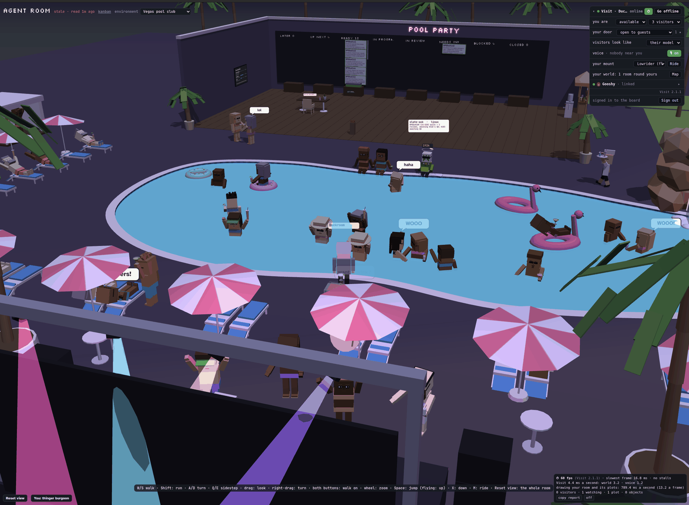

<p align="center">
  <picture>
    <source media="(prefers-color-scheme: dark)" srcset=".github/assets/logo-dark.svg">
    
  </picture>
</p>

# basedverse — walk around each other's workrooms

Everyone builds their own workroom (an agent-office sim, in their own engine), and basedverse is what
they share: a lobby to meet in, and **Visit**, to walk around each other's rooms with WASD and the mouse.
Every room is made with three.js: a host shares its scene, and the visitor's browser draws the room itself,
so walking in it is as quick as in your own. What everyone agrees on is a thin interface: a host's scene and
two hooks, and two pieces everyone drops in unchanged.

<p align="center">
  
  <br>
  <em>In a friend's room: Gooshy's office, with GOOSHY on the ground, drawn by your own page from what his room sends. The panel is yours; the room is his.</em>
</p>

<p align="center">
  
  <br>
  <em>A workroom: the office. Its kanban board on the wall, and an agent's console, open beside you.</em>
</p>

<p align="center">
  
  <br>
  <em>Another: the jungle sweatshop. Time since last accident: 26 seconds (death by exhaustion). Rat vs. snake: 14–14.</em>
</p>

<p align="center">
  
  <br>
  <em>And another: the Vegas pool club. POOL PARTY over the kanban board, and the agents in the pool: WOOO.</em>
</p>

<p align="center">
  
  <br>
  <strong>Chat, share assets, and do voice calls</strong>
</p>

| | |
|---|---|
| [visit/](visit/) | Visit: **`visit`**, the one program a workroom runs (Rust: all the networking, with its database, the sign-in and the engine inside it), and **visit.js** (the library for the workroom's page), [the spec](visit/SPEC.md), [the integration guide](visit/INTEGRATING.md) and [bodies, things and positions](visit/MODELS.md), written for the coding agent doing it |
| [auth/](auth/) | **the sign-in**, inside `visit`: a workroom's own (the owner's account, made in a terminal; sessions; API keys for scripts and agents), [its spec](auth/SPEC.md), [its integration guide](auth/INTEGRATING.md), and [the sign-in page](auth/web/login.html) to start from |
| [engine/](engine/) | **the engine**, inside `visit`: your room's page in a headless Chrome, your browser one more client of it, from the desk or anywhere; the owner is the room's visitor. [engine/SPEC.md](engine/SPEC.md) is the contract, [engine/INTEGRATING.md](engine/INTEGRATING.md) the guide for your coding agent |
| [deps/](deps/) | how the Postgres and the Chrome inside `visit` are built, tested on every platform and pinned ([deps/README.md](deps/README.md)) |
| [lobby/](lobby/) | the lobby server everyone connects to (Python): presence, knocks, introductions. [Its protocol](lobby/PROTOCOL.md), its tests, and its deployment (Caddy for TLS, coturn) |
| [bin/setup](bin/setup) | sets up Visit for a workroom: the lobby (or deploys your own), your office, `visit` for your machine, where it keeps the workroom's data, the owner's account, your `.env`; a 1.x workroom's database moved in |
| [bin/deploy-lobby](bin/deploy-lobby) | puts the lobby on a server over ssh, and updates it |
| [CHANGELOG.md](CHANGELOG.md) | every release: what changed, and what an integration does about it (read it to upgrade) |
| [.env.example](.env.example) | every setting, with nothing real in it: the template for a workroom's `visit` settings, and for running the lobby |

## Adding Visit to a workroom

**With Claude Code**, the easiest way: install basedverse's plugin once, then, in your workroom's project, run its
skill. It lists Visit's features and which your room uses, answers your questions, plans the work with you (Visit's
vanilla experience unless you say otherwise), does it when you say go, and keeps a `VISIT.md` in your workroom with
your choices, so that later upgrades keep them. Run it again after a new release to upgrade.

```
/plugin marketplace add sarmiena/Basedverse
/plugin install basedverse@basedverse
/basedverse:visit
```

(Claude Code 2.1.275 or later can install it in one line: `/plugin install basedverse --marketplace
sarmiena/Basedverse`. Updates: `/plugin marketplace update basedverse`.)

**With any coding agent**, paste this, in your workroom's project, with the lobby's address filled in (ask
whoever runs your lobby):

> Clone https://github.com/sarmiena/Basedverse beside this project, then integrate Visit into my
> workroom, following its visit/INTEGRATING.md. The lobby is wss://&lt;the lobby's address&gt;/.

The guide takes it from there. Early on, it has the agent ask you to run `bin/setup` in a terminal: it
asks you for the lobby (an address you have, or your own server, where it deploys one), your office's name
and your page's address, gets `visit` for your machine, and writes your workroom's `.env`. Then the
agent writes the launcher, the token handoff, the scene and hooks, and the UI, and tests it on one machine.
Your workroom must be made with three.js (r125 to r186): that is what every room shares. Nothing is installed:
`visit` is one file for Linux, macOS or Windows, with its database (a Postgres) and a headless Chrome inside it,
and Docker is never needed to run a workroom. A room on Visit 1.x (visit-client, auth-client, a Postgres beside
them) is upgraded first, by the guide's "Upgrading a 1.x room to 2.0" (the skill does it for you).
By hand, that is:

1. **Get this repository** (`git clone https://github.com/sarmiena/Basedverse`) anywhere; beside your
   workroom's project is the usual place.
2. **Run `python3 Basedverse/bin/setup --env <your workroom>/.env`** (Windows: `py`). Or, for
   `visit` alone: download it from the
   [newest release](https://github.com/sarmiena/Basedverse/releases/latest) (Linux, macOS, Windows), or
   build it (step 1 of the guide says how).
3. **Follow [visit/INTEGRATING.md](visit/INTEGRATING.md)**, or hand it to your coding agent.

## Signing in to your workroom

A workroom's server takes whoever can reach it for its owner. **The sign-in** (from 0.21; inside `visit` from 2.0)
gives every workroom a real one, built from standard pieces, so that none of them invents one: the owner's account
is made in a terminal (`visit auth user add`: there is no sign-up page, ever), sessions are checked by the
workroom's server before every page and route, scripts and agents get API keys, and `visit`'s token goes only to a
signed-in session. `visit` serves it on `127.0.0.1`, and only the workroom's server talks to it. `bin/setup` makes
the account; [auth/INTEGRATING.md](auth/INTEGRATING.md) is the rest, for your coding agent (the plugin's skill
offers it).

<p align="center">
  
  <br>
  <em>The sign-in page every workroom starts from (<a href="auth/web/login.html">auth/web/login.html</a>): one file, its world drawn by itself.</em>
</p>

## Running the lobby

One small server for everyone: [lobby/README.md](lobby/README.md) says what to rent and which ports to
open, then `bin/deploy-lobby user@server` sets it up, and later updates it.

## Releasing `visit`

A release is one program, `visit`, at one version. Set it in the workspace's three crates
(`visit/client/Cargo.toml`, `auth/client/Cargo.toml`, `engine/Cargo.toml`) and `VERSION` in
`visit/client/web/visit.js`, and add its entry at the top of [CHANGELOG.md](CHANGELOG.md): what changed, and
**what an integration does**, step
by step, for the agent upgrading a workroom. A new feature also gets a row in the plugin skill's "Where to look"
table (`plugins/basedverse/skills/visit/SKILL.md`), and, if it is a default, a line in INTEGRATING.md's "The
vanilla experience". Commit, then tag that commit `v<version>` and push the tag
(`git tag v0.3.0 && git push origin v0.3.0`). [The release workflow](.github/workflows/release.yml)
builds and tests `visit` on Linux (x86_64, ARM64), macOS (Apple silicon, Intel) and Windows (x86_64), starts it
fresh on each (its Postgres up, a user made and signed in through its API, a room page hosted by its engine), and
publishes `visit-<target>` (`.tar.gz`, `.zip` on Windows), with `SHA256SUMS`, as that tag's release, its notes the
changelog's entry (a tag the changelog has no entry for is not released).

The Postgres and the Chrome inside `visit` are released apart, as `deps-<n>`, when one of them is upgraded
([deps/README.md](deps/README.md)): a Visit release carries whatever `deps/pinned.json` says at its commit.

## Tests

| | |
|---|---|
| `python3 lobby/server/test_lobby.py`, `python3 lobby/server/test_lobby2.py` | the lobby, versions 1 and 2 (they need `websockets`: `lobby/server/requirements.txt`) |
| `visit/client/cargo test` | `visit`'s unit tests, in Docker |
| `visit/client/tests/run-e2e.sh` | the lobby, two `visit`s (each with the Postgres inside it) and two stand-in pages, in Docker |
| `visit/client/tests/run-browser.sh` | visit.js in two headless Chromes on this machine (it needs `google-chrome`): a three.js room's scene, drawn by its visitor; two rooms' worlds (on different three.js releases); a room hosted by the engine inside its `visit` |
| `engine/tests/run-engine.sh` | `visit` with its engine, in a bare container, hosting a test room against a stand-in server: loads, hosts, reloads, idles, measures |
| `auth/client/cargo test` | the sign-in's unit tests, in Docker |
| `auth/client/tests/run-e2e.sh` | the sign-in inside `visit`, in Docker: the database's roles apart; its terminal commands, on a running `visit`'s database and on one started for them; its API (signing in, guesses slowed, expiry, revoking, keys); `visit import` |
| `deps/postgres/build <platform>`, `deps/chrome/build <platform>` | the Postgres and the Chrome inside `visit`, each built and tested (a Linux one in Docker, on bare Ubuntu 20.04 and Debian 12; deps/README.md) |
| `visit/client/tests/perf/run-perf.sh` | visits through simulated networks (delay, jitter, loss, rate caps; several visitors), each in its own container: the host's answer, updates, stalls, bandwidth (and with `BROWSERS=1`, real browsers drawing), against targets |

## License

MIT: see [LICENSE](LICENSE).
