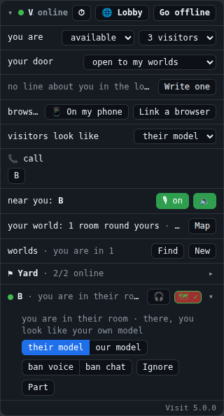
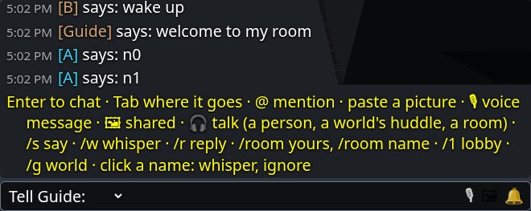
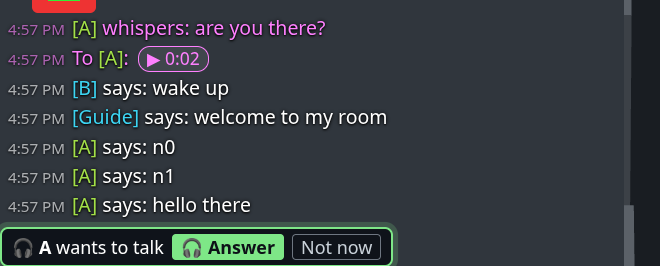
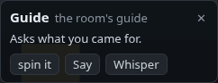
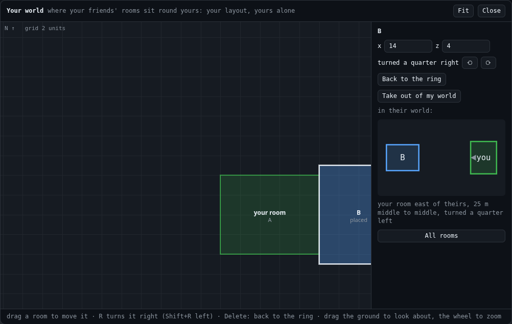
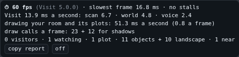

# Your room's UI

Since 5.0 (#82), Visit puts **no UI in your page**. There is no panel, chat window, map, stage bar, target card or ⏱
corner from visit.js. Everything a person clicks, types or reads around the 3D is your room's own: its HTML, its CSS
and its code. Visit gives you the state, the actions and the events to build it from (SPEC.md section 9). This guide
says what each piece does and what it is built on.

**Why.** Rooms used to reach into Visit's own UI to fit it to themselves: a row added inside its panel, its card turned
off for their own. Any upgrade that changed that markup could break them. Now the UI is the room's code, so an upgrade
changes only the API under it, and the CHANGELOG says when it does.

**What Visit still draws** is only what is inside the 3D views it is given:
- the room your user visits (`v.view(element)`);
- your own room, first person (`v.homeView(element)`);
- your world (`v.world(...)`).

In those views it draws people's bodies and mounts, chat bubbles over speakers, the 🔊 over whoever your user hears,
and, in a view, the crosshair and the label of what it points at. It also plays voices and room sounds.

## Two ways to have one

1. **Copy the reference UI.** [`examples/ui/visit-ui.js`](examples/ui/visit-ui.js) is the UI Visit used to draw,
   rewritten on the public API alone. It contains the panel, the chat window, the target card, the map, the stage bar
   and the ⏱ corner. Copy it into your room's tree, serve it with your page, and change whatever your user wants: it is
   yours. visit-client never serves it, so a Visit upgrade never changes your copy. When a new Visit adds something you
   want, read its CHANGELOG and the reference's diff, and take what you like.
2. **Build your own** from the sections below, in your room's own style. Any mix works: the reference's chat window
   with your own panel, say.

Either way, write down in your workroom (a `VISIT.md`) what you changed and why, in your user's words. Then an upgrade
keeps it.

### The reference UI, in five lines

```html
<script src="/your/copy/of/visit-ui.js"></script>   <!-- before or after visit.js: it reads Visit when called -->
```

```js
const visit = await Visit.connect({ ... });
const ui = VisitUI.panel(document.getElementById("visit-panel"), visit);   // the HUD, with the chat window, the
                                                                           // target card and the ⏱ corner
VisitUI.stage(visit);   // a page that draws no world of its own: your room, first person, and the room visited
```

- `VisitUI.panel(element, v, { chat, card })`: `chat: false` or `card: false` leaves that piece out.
- It returns `{ element, chat, card, perf, map, say(), release() }`.
- `ui.chat.aim(target)` points the chat box at someone (the card's Say and Whisper do this).
- Each piece also stands alone: `VisitUI.chat(v, { element, fade })`, `VisitUI.targetCard(v, { chat })`,
  `VisitUI.map(v)`, `VisitUI.perf(v)` and `VisitUI.stage(v)`.

Its class names and the chat window's CSS variables are the file's own:
- the classes `.visit-panel`, `.visit-chat`, `.visit-card`, `.visit-map`, `.visit-stage`, `.visit-home-box`,
  `.visit-perf` and `.visit-lightbox`;
- `.visit-folded` on the panel's element while it is folded;
- the variables `--visit-chat-left` and `--visit-chat-bottom`.

Style them from your page, or change them in your copy.

## The panel (the HUD)



The reference puts it top right, in an element of your page's. It folds to its first line; while folded it still shows
whatever asks for an answer, such as a call ringing.

| What it shows | Built on |
|---|---|
| Your office, online or not, ⏱, 🌐 Lobby, Go offline / online | `v.office`, `v.state` ("change"), `v.perfOn`, `v.perf(on)`, `v.openLobby()`, `v.leaveLobby()`, `v.joinLobby()` |
| ✦ (Teleport, 5.1, in the first line): the rooms that would take you, your own first but the one you are in, each with Teleport; asking; why one did not | `v.findTeleports()`, `v.teleportTargets` ("teleports"), `v.teleportAsking`, `v.teleportLobby`, `v.teleport(key)`, `v.teleporting`, "teleport", `v.roomHere` |
| Not in the lobby because nobody is signed in; the lobby's title and message | `v.signedIn`, `v.lobbyInfo` |
| Your status, how many visitors, your door | `v.status`, `v.maxVisitors`, `v.door`, `v.setStatus()`, `v.setMaxVisitors()`, `v.setDoor()` |
| Your line in the lobby's list | `v.about`, `v.setAbout(text, tags)` |
| Browsers linked to you, 📱 a QR code for a phone, Link a browser | `v.browsers` ("browsers"), `v.lobbyQr()`, `v.linkBrowser(code)`, `v.allowBrowser(code)`, `v.browserPending`, `v.browserConfirm`, `v.unlinkBrowser(key)`, `v.listBrowsers()` |
| Whom you ignore in chat | `v.ignored` ("ignored"), `v.unignore()`, `v.clearIgnored()`, `Visit.limits.maxIgnored`, `v.nameOf(key)` |
| How visitors look in your room | `v.avatars`, `v.useAvatars(use)`, `v.useAvatar(key, use)`, `v.avatarUse(key)` |
| 📞 call, and the calls going on | `v.hasPhone`, `v.phones`, `v.calls` ("call"), `v.call()`, `v.pickUp()`, `v.hangUp()`, `v.speaker()` |
| Voice: who is near, 🎙, 🔈 | `v.voices`, `v.mic`, `v.setMic(on)`, `v.roomSounds`, `v.setRoomSounds(on)` |
| The room voice or huddle you are in | `v.roomVoice`, `v.inHuddle`, `v.joinVoice(null)` |
| Your mount, Ride / Get off, M | `v.mounts`, `v.mount`, `v.riding`, `v.ride(id)`, `v.setMount(id)` |
| Your world: rooms round yours, picks, Map | `v.currentWorld.plots`, `v.picks`, `Visit.limits.maxPicks` |
| Your worlds: members, Find, New, an owner's ✕ ⛔ ♛ 🔒 | `v.groups`, `v.groupList`, `v.findGroups()`, `v.createGroup()`, `v.joinGroup()`, `v.leaveGroup()`, `v.removeFromGroup()`, `v.unbanFromGroup()`, `v.handGroup()`, `v.setGroup()`, `v.deleteGroup()`, `v.isGroupOwner()` |
| People, one row each: where you two stand, 🎧, 🗺 + / ✓, and opened: their model here, your model there, bans, Kick, Ignore, Part | `v.offices`, `v.groupsWith(key)`, `v.visitors`, `v.watchers`, `v.watches` (each `body`: how that room draws you), `v.userOf(key)`, `v.canTalk(key)`, `v.talk(key)`, `v.isGuest()`, `v.isPicked()`, `v.pick()`, `v.unpick()`, `v.voiceMembers`, `v.bannedBy`, `v.banOf()`, `v.ban()`, `v.voiceKick()`, `v.kick(id)`, `v.ignore()` |
| Notes for a while: where a friend's world put your room, a call that ended badly, a model that can't be shown, a browser just linked | "seen" (`v.plotMetres` to say how far), "call", "model", "body", "browsers" |
| Visit's version at its foot | `Visit.version` |

It redraws on "change", and every 250 ms while anyone is speaking. It never redraws under a hand typing in one of its
boxes.

## The chat window



The reference puts it bottom left, as a game's chat is.

**Typing and where a line goes:**
- Enter opens the box, Enter says the line, and Esc closes it. Typing `/` opens it with the `/` already there.
- Where the line goes is picked before the box, and stays for the next line:
  - Say: everyone near you, within 45 m;
  - Tell name: a whisper;
  - your room's chat or a friend's;
  - Lobby;
  - one of your worlds.
- Commands: `/s`, `/w name`, `/r`, `/room`, `/room name`, `/1`, `/g name`, `/ignore`, `/unignore`, `/voice`.
- Tab finishes a name, or else moves the box to the next place (Shift+Tab goes back). `@` mentions someone.

**Shared things:** paste or drop a picture; 🎙 records a voice message, at most a minute; 🖼 shows what was shared in
this conversation.

**The mailbox:** 📬 holds what came for your user while nobody was looking. Whispers left for someone away are held
until they are back.

**Talking and ringing:**
- 🎧 talks with whoever the box talks to: a person, a world's huddle, or a room's voice.
- A call or a huddle rings above the box until it is answered.
- While you talk, a line over the box says with whom.



**Names:** click a name in the log to whisper to them or ignore them.

**Fading:** the window fades a while after the last line, and comes back with the next one or with Enter.

| What it does | Built on |
|---|---|
| Lines as they come, and the last 100 | "chat" (each line: `scope`, `key`, `name`, `text`, `mine`, `to`, `media`, `links`, `conversation`, `mention`, `old`, ...), `v.chatLog` |
| Older lines, scrolled up | `v.history({ before, limit })` |
| Saying | `v.say(text, to, { media, links })`, `Visit.limits.chatLen`, `.chats`, `.chatWindowMs` (its "too fast") |
| Where a line can go | `v.whisperTargets`, `v.awayTargets`, `v.chatTargets`, `v.lobbyChat`, `v.groups`, `v.roomHere` (the room you are in and its conversation), `v.nameOf(key)` |
| Figures of the room you are in, and whom you may talk to | `v.figuresHere`, `v.mayTalk(figure)`, `v.say(text, { target })`, `v.say(text, { whisper: { kind: "figure", id } })` |
| Pictures, voice messages, links | `v.share(blob)`, `v.media(id)`, `v.preview(url)`, `v.shared(conversation, kind)`, `Visit.limits.voiceSecs`, `.voiceMax`, `.voiceKinds` |
| The mailbox, and whether someone is looking | `v.unseen` ("unseen"), `v.read(conversation)`, `v.held` ("held", "held_sent"), `v.unhold(id)`, `v.attention(on)` (tell it while the page is shown, focused, and used in the last 2 minutes) |
| 🎧, rings | `v.roomVoice` ("room_voice"), `v.joinVoice(key)`, `v.talk(key)`, `v.calls` ("call"), `v.pickUp()`, `v.hangUp()`, `v.huddles` ("huddle"), `v.huddle()`, `v.joinHuddle()` |
| Ignoring, bans, worlds joined and left | `v.ignore()`, `v.unignore()`, "ignored", "banned", "group", "group_left", "online", "signed_in" |
| Errors worth a line | "error" (`{ code, message, ref }`) |

The reference also makes a soft sound for a line that comes, and a ring for a call or a huddle. It plays them with Web
Audio, which a browser lets a page start only after a click or a key.

## Your target's card



This is the reference's card for your user's target (3.3), top middle. It shows the target's name and a figure's title
and line. Its buttons:
- a figure's actions, which run by its room's rules;
- Say: aloud, meant for the target;
- Whisper: to a figure alone, or to a person through the lobby;
- 🎧 Talk;
- ✕: no target.

| What it does | Built on |
|---|---|
| The target, as it changes | `v.target` ("target"), `v.setTarget(t)`, `v.targeting(on)` (false: your page picks targets itself) |
| A figure's buttons | `v.actionsOf(target)` (`[{ type, label }]`), `v.act(id, type)`, `v.mayTalk(target)` |
| Say and Whisper | the chat window's box, pointed there (the reference: `ui.chat.aim(...)`) |
| 🎧 Talk | `v.canTalk(key)`, `v.talk(key)` |

## The map



The panel's **Map** shows your world from above. In it you can:
- drag a friend's room to move it (it snaps to half units, and flush against rooms near it);
- turn a room with R (Shift+R turns the other way), or type where its middle goes;
- send a room back to the ring with Delete;
- take a room out of your world;
- pick a friend to see their view of the two of you.

| What it does | Built on |
|---|---|
| Your plot, and each friend's where your layout puts it | `v.plot` (your units), `v.currentWorld.layout()` (each plot: `at`, `rect`, `size`, `offline`, `home`), `v.layout` |
| Placing | `v.place(key, { x, z, turn })`, `v.unplace(key)`, `v.unpick(key)` ("change" once it is kept) |
| Their view of you two | `v.seen` ("seen": `{ key, name, at: { dx, dz, turn, size } }`), `v.plotMetres` |

## The ⏱ corner



The corner shows how the page is doing, a row a second while `v.perf` measures:
- frames a second, and the slowest frame;
- stalls (long tasks);
- Visit's own work, part by part;
- the time spent drawing your room, and its draw calls;
- pictures encoded;
- how much there is: visitors, plots and objects.

**copy report** copies the last two minutes; **off** stops measuring.

| What it does | Built on |
|---|---|
| On and off, kept in this browser (or `?visit-perf=1`) | `v.perf(on)`, `v.perfOn` ("change") |
| Each second | "perf": `{ visit, t, fps, frame_p95_ms, frame_max_ms, long_tasks, long_max_ms, parts: { scan, send, whole, landscape, world, voice, draw, textures: { n, ms, max } }, draws: { colour, shadow }, counts: { visitors, watchers, plots, offline, objects, landscape, voices, visiting } }` |
| copy report | `v.perfReport()` |

## The stage, and your own room

On a page that draws no world of its own (engine/SPEC.md 7), the reference stage does two things:
- It puts your user's own room behind everything, first person, with a line under it (`v.homeView` draws it).
- While they visit a room, it shows that room full-window or in a corner, with how the link is going, **Back to my
  room** and **Leave**.

A page with its own world needs none of it: rooms are visited by walking onto their plots.

| What it does | Built on |
|---|---|
| Your own room, first person | `v.homeView(element)` → `{ element, shown, release() }` (it draws only while `shown`: not while visiting, nor once your page makes a world); `v.home` (`paused`: your room reloading) |
| The room visited | `v.visiting` ("change"), `v.view(element)` → `{ setActive(on), active, release() }`, `v.viewFocused` |
| How it is going, Leave | `v.stats` ("stats": `path`, `rtt`, `latency`, `fps`), `v.kick(v.visiting.id)` |

## Upgrading a 4.x room

1. **Copy `examples/ui/visit-ui.js` into your room's tree,** serve it, and load it with your page.
2. **Rename the calls:**
   - `Visit.panel` → `VisitUI.panel`
   - `Visit.chat` → `VisitUI.chat`
   - `Visit.map` → `VisitUI.map`
   - `Visit.stage` → `VisitUI.stage`

   The options are the same (`{ chat: false }`, `{ card: false }`), and so are the classes and CSS variables.
   `Visit.panel` and the others now throw, and the error says where they went.
3. **Make your copy hold what you added to Visit's UI.** A row you appended inside the panel can now be a line in your
   copy's `draw()`. A card you turned off can be taken out of your copy.
4. **Find the reference's handles where Visit's events used to be.**
   - The chat box: `v._emit("chat_box", ...)` → `ui.chat.aim(...)`.
   - The ⏱ corner: `v.perf(true)` measures but no longer draws its own corner; `VisitUI.perf(v)` draws it (the
     panel makes one).

Nothing changes a protocol's name, so offices on 4.x and 5.0 still meet and visit each other.
