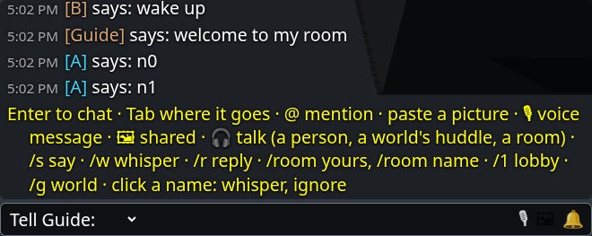
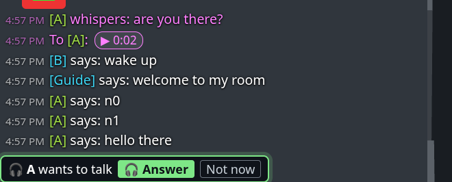

# The chat window

**Gives your user:** chat: lines said near them, whispers, their room's chat, a world's, the lobby's; pictures, voice messages and links; the mailbox; talking (🎧) and rings.

**Your room needs it:** always: chat bubbles in the 3D are Visit's, but typing a line, whispering and reading what came is your page's.

**The reference:** `VisitUI.chat(v, { element, fade, sound })`, made by the panel unless `chat: false`; bottom left, as in a game. `ui.chat.aim(target)` points its box at someone.

The reference puts it bottom left, as a game's chat is.

**Typing and where a line goes:**
- Enter opens the box, Enter says the line, and Esc closes it. Typing `/` opens it with the `/` already there.
- Where the line goes is picked before the box, and stays for the next line:
  - Say: everyone near you, within 45 m;
  - Tell name: a whisper;
  - your room's chat or a friend's;
  - Lobby;
  - one of your worlds.
- Commands: `/s`, `/w name`, `/r`, `/room`, `/room name`, `/1`, `/g name`, `/ignore`, `/unignore`, `/voice`.
- Tab finishes a name, or else moves the box to the next place (Shift+Tab goes back). `@` mentions someone.

**Shared things:** paste or drop a picture (a screenshot, say); 🎙 records a voice message, at most a minute; 🖼 shows
what was shared in this conversation. They go wherever the box talks to but the lobby's own chat: near, a room's chat,
a whisper to someone you are linked with, and (5.3) a world's chat, through a lobby that passes them on.

**The mailbox:** 📬 holds what came for your user while nobody was looking. Whispers left for someone away are held
until they are back.

**Talking and ringing:**
- 🎧 talks with whoever the box talks to: a person, a world's huddle, or a room's voice.
- A call or a huddle rings above the box until it is answered.
- While you talk, a line over the box says with whom.

**Names:** click a name in the log to whisper to them or ignore them.

**Fading:** the window fades a while after the last line, and comes back with the next one or with Enter.

| What it does | Built on |
|---|---|
| Lines as they come, and the last 100 | "chat" (each line: `scope`, `key`, `name`, `text`, `mine`, `to`, `media`, `links`, `conversation`, `mention`, `old`, ...), `v.chatLog` |
| Older lines, scrolled up | `v.history({ before, limit })` |
| Saying | `v.say(text, to, { media, links })`, `Visit.limits.chatLen`, `.chats`, `.chatWindowMs` (its "too fast") |
| Where a line can go | `v.whisperTargets`, `v.awayTargets`, `v.chatTargets`, `v.lobbyChat`, `v.lobbyMedia` (5.3: pictures in a world's chat), `v.groups`, `v.roomHere` (the room you are in and its conversation), `v.nameOf(key)` |
| Figures of the room you are in, and whom you may talk to | `v.figuresHere`, `v.mayTalk(figure)`, `v.say(text, { target })`, `v.say(text, { whisper: { kind: "figure", id } })` |
| Pictures, voice messages, links | `v.share(blob)`, `v.media(id)`, `v.preview(url)`, `v.shared(conversation, kind)`, `Visit.limits.voiceSecs`, `.voiceMax`, `.voiceKinds` |
| The mailbox, and whether someone is looking | `v.unseen` ("unseen"), `v.read(conversation)`, `v.held` ("held", "held_sent"), `v.unhold(id)`, `v.attention(on)` (tell it while the page is shown, focused, and used in the last 2 minutes) |
| 🎧, rings | `v.roomVoice` ("room_voice"), `v.joinVoice(key)`, `v.talk(key)`, `v.calls` ("call"), `v.pickUp()`, `v.hangUp()`, `v.huddles` ("huddle"), `v.huddle()`, `v.joinHuddle()` |
| Ignoring, bans, worlds joined and left | `v.ignore()`, `v.unignore()`, "ignored", "banned", "group", "group_left", "online", "signed_in" |
| Errors worth a line | "error" (`{ code, message, ref }`) |

The reference also makes a soft sound for a line that comes, and a ring for a call or a huddle. It plays them with Web
Audio, which a browser lets a page start only after a click or a key.

## If you build your own, it must

- open with a key (Enter, say) and say a line where the user picks (near, a whisper, a room, the lobby, a world);
- send a picture pasted or dropped with the line, a world's line too while `v.lobbyMedia` (5.3);
- show each line as it comes, and older ones on asking;
- show what came while nobody looked (the mailbox), and tell Visit when someone is looking (`v.attention(on)`);
- ring for a call or a huddle until it is answered.

## Check

Two rooms: a line said near the other is over the sayer's head and in both logs; a whisper reaches the other alone; a picture pasted shows on both, said near and (5.3) in a world they share.

[All widgets](README.md) · [UI.md](../UI.md): why your page's UI is your own
