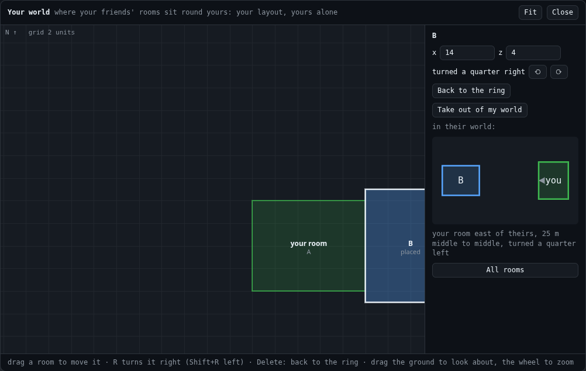

# The map

**Gives your user:** their world from above: where each friend's room sits round theirs, to move, turn or take out; a friend's view of the two of them.

**Your room needs it:** when your page draws a world (`v.world`): without it, a room put in the ring stays where the ring put it.

**The reference:** `VisitUI.map(v).open()`, the panel's **Map**.

The panel's **Map** shows your world from above. In it you can:
- drag a friend's room to move it (it snaps to half units, and flush against rooms near it);
- turn a room with R (Shift+R turns the other way), or type where its middle goes;
- send a room back to the ring with Delete;
- take a room out of your world;
- pick a friend to see their view of the two of you.

| What it does | Built on |
|---|---|
| Your plot, and each friend's where your layout puts it | `v.plot` (your units), `v.currentWorld.layout()` (each plot: `at`, `rect`, `size`, `offline`, `home`), `v.layout` |
| Placing | `v.place(key, { x, z, turn })`, `v.unplace(key)`, `v.unpick(key)` ("change" once it is kept) |
| Their view of you two | `v.seen` ("seen": `{ key, name, at: { dx, dz, turn, size } }`), `v.plotMetres` |

## If you build your own, it must

- show your plot and each friend's where your layout puts it;
- let your user place, turn and send back each one (`v.place`, `v.unplace`), and take one out (`v.unpick`);
- show where a friend's world has your room (`v.seen`).

## Check

Two rooms, each in the other's world: dragging the other's room moves it in your world, and the other sees where you put them.

[All widgets](README.md) · [UI.md](../UI.md): why your page's UI is your own
