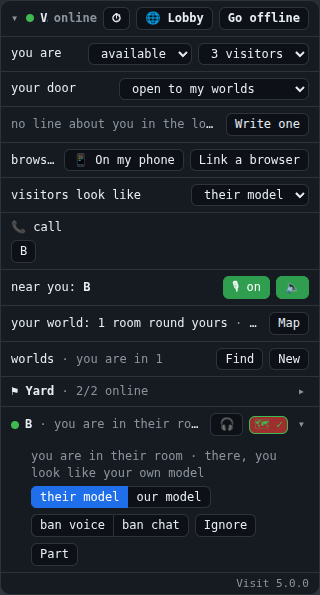

# The panel (the HUD)

**Gives your user:** who they are in the lobby, their door and status, their worlds and the people in them, voice, calls, their mount, their world's rooms, and the way into the other widgets (Map, ⏱, ✦).

**Your room needs it:** always: it is how your user takes part in the lobby (going online and offline, worlds, people, the door). A room with its own HUD shows the same things its own way.

**The reference:** `VisitUI.panel(element, v, { chat, card })` ([examples/ui/visit-ui.js](../examples/ui/visit-ui.js)), top right in an element of your page's; it makes the [chat window](chat.md), the [target card](target-card.md) and the [⏱ corner](perf.md) too (`chat: false`, `card: false` leave them out). It returns `{ element, chat, card, perf, map, say(), teleports(on), release() }`.

The reference puts it top right, in an element of your page's. It folds to its first line; while folded it still shows
whatever asks for an answer, such as a call ringing.

| What it shows | Built on |
|---|---|
| Your office, online or not, ⏱, 🌐 Lobby, Go offline / online | `v.office`, `v.state` ("change"), `v.perfOn`, `v.perf(on)`, `v.openLobby()`, `v.leaveLobby()`, `v.joinLobby()` |
| ✦ (Teleport, 5.1, in the first line): the rooms that would take you, your own first but the one you are in, each with Teleport; asking; why one did not | `v.findTeleports()`, `v.teleportTargets` ("teleports"), `v.teleportAsking`, `v.teleportLobby`, `v.teleport(key)`, `v.teleporting`, "teleport", `v.roomHere` |
| Not in the lobby because nobody is signed in; the lobby's title and message | `v.signedIn`, `v.lobbyInfo` |
| Your status, how many visitors, your door | `v.status`, `v.maxVisitors`, `v.door`, `v.setStatus()`, `v.setMaxVisitors()`, `v.setDoor()` |
| Your line in the lobby's list | `v.about`, `v.setAbout(text, tags)` |
| Browsers linked to you, 📱 a QR code for a phone, Link a browser | `v.browsers` ("browsers"), `v.lobbyQr()`, `v.linkBrowser(code)`, `v.allowBrowser(code)`, `v.browserPending`, `v.browserConfirm`, `v.unlinkBrowser(key)`, `v.listBrowsers()` |
| Whom you ignore in chat | `v.ignored` ("ignored"), `v.unignore()`, `v.clearIgnored()`, `Visit.limits.maxIgnored`, `v.nameOf(key)` |
| How visitors look in your room | `v.avatars`, `v.useAvatars(use)`, `v.useAvatar(key, use)`, `v.avatarUse(key)` |
| 📞 call, and the calls going on | `v.hasPhone`, `v.phones`, `v.calls` ("call"), `v.call()`, `v.pickUp()`, `v.hangUp()`, `v.speaker()` |
| Voice: who is near, 🎙, 🔈 | `v.voices`, `v.mic`, `v.setMic(on)`, `v.roomSounds`, `v.setRoomSounds(on)` |
| The room voice or huddle you are in | `v.roomVoice`, `v.inHuddle`, `v.joinVoice(null)` |
| Your mount, Ride / Get off, M | `v.mounts`, `v.mount`, `v.riding`, `v.ride(id)`, `v.setMount(id)` |
| Your world: rooms round yours, picks, Map | `v.currentWorld.plots`, `v.picks`, `Visit.limits.maxPicks` |
| Your worlds: members, Find, New, an owner's ✕ ⛔ ♛ 🔒 | `v.groups`, `v.groupList`, `v.findGroups()`, `v.createGroup()`, `v.joinGroup()`, `v.leaveGroup()`, `v.removeFromGroup()`, `v.unbanFromGroup()`, `v.handGroup()`, `v.setGroup()`, `v.deleteGroup()`, `v.isGroupOwner()` |
| People, one row each: where you two stand, 🎧, 🗺 + / ✓, and opened: their model here, your model there, bans, Kick, Ignore, Part | `v.offices`, `v.groupsWith(key)`, `v.visitors`, `v.watchers`, `v.watches` (each `body`: how that room draws you), `v.userOf(key)`, `v.canTalk(key)`, `v.talk(key)`, `v.isGuest()`, `v.isPicked()`, `v.pick()`, `v.unpick()`, `v.voiceMembers`, `v.bannedBy`, `v.banOf()`, `v.ban()`, `v.voiceKick()`, `v.kick(id)`, `v.ignore()` |
| Notes for a while: where a friend's world put your room, a call that ended badly, a model that can't be shown, a browser just linked | "seen" (`v.plotMetres` to say how far), "call", "model", "body", "browsers" |
| Visit's version at its foot | `Visit.version` |

It redraws on "change", and every 250 ms while anyone is speaking. It never redraws under a hand typing in one of its
boxes.

## If you build your own, it must

- show whether your user is online, and let them go offline and back;
- show and set their status, how many visitors they take, and their door;
- list their worlds (join, leave, make one; an owner's tools) and the people they can reach (talk, pick their room,
  kick, ignore, part);
- run the microphone, show who is near and speaking, and ring for calls;
- reach the other widgets your room has: the [map](map.md), [⏱](perf.md), [teleport](teleport.md).

## Check

Two rooms (INTEGRATING.md step 8): each sees the other in the lobby, joins a world, picks the other's room, goes offline and back, and rings the other.

[All widgets](README.md) · [UI.md](../UI.md): why your page's UI is your own
