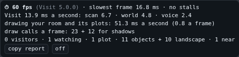

# The ⏱ corner

**Gives your user:** how their page is doing, a row a second: frames, stalls, Visit's own work, draw calls; a report to copy.

**Your room needs it:** optional: a tool for when a room feels slow (INTEGRATING.md, Troubleshooting).

**The reference:** `VisitUI.perf(v)`, made by the panel (its ⏱).

The corner shows how the page is doing, a row a second while `v.perf` measures:
- frames a second, and the slowest frame;
- stalls (long tasks);
- Visit's own work, part by part;
- the time spent drawing your room, and its draw calls;
- pictures encoded;
- how much there is: visitors, plots and objects.

**copy report** copies the last two minutes; **off** stops measuring.

| What it does | Built on |
|---|---|
| On and off, kept in this browser (or `?visit-perf=1`) | `v.perf(on)`, `v.perfOn` ("change") |
| Each second | "perf": `{ visit, t, fps, frame_p95_ms, frame_max_ms, long_tasks, long_max_ms, parts: { scan, send, whole, landscape, world, voice, draw, textures: { n, ms, max } }, draws: { colour, shadow }, counts: { visitors, watchers, plots, offline, objects, landscape, voices, visiting } }` |
| copy report | `v.perfReport()` |

## If you build your own, it must

- turn measuring on and off (`v.perf(on)`), and show each second's row ("perf");
- copy the report (`v.perfReport()`).

## Check

⏱ on: a row a second; copy report gives two minutes of rows; off stops it.

[All widgets](README.md) · [UI.md](../UI.md): why your page's UI is your own
