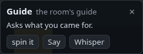

# Your target's card

**Gives your user:** who or what their click picked in the room they are in: a person, or a room's figure with its actions, Say and Whisper.

**Your room needs it:** when the rooms your user visits have figures (3.3), or your room picks targets itself. Without one, a figure's actions are out of your user's reach.

**The reference:** `VisitUI.targetCard(v, { chat })`, made by the panel unless `card: false`; top middle.

This is the reference's card for your user's target (3.3), top middle. It shows the target's name and a figure's title
and line. Its buttons:
- a figure's actions, which run by its room's rules;
- Say: aloud, meant for the target;
- Whisper: to a figure alone, or to a person through the lobby;
- 🎧 Talk;
- ✕: no target.

| What it does | Built on |
|---|---|
| The target, as it changes | `v.target` ("target"), `v.setTarget(t)`, `v.targeting(on)` (false: your page picks targets itself) |
| A figure's buttons | `v.actionsOf(target)` (`[{ type, label }]`), `v.act(id, type)`, `v.mayTalk(target)` |
| Say and Whisper | the chat window's box, pointed there (the reference: `ui.chat.aim(...)`) |
| 🎧 Talk | `v.canTalk(key)`, `v.talk(key)` |

## If you build your own, it must

- show the target as it changes, and clear it;
- run a figure's actions (`v.actionsOf(target)`, `v.act(...)`);
- let your user say something meant for it, or whisper to it.

## Check

In a room with a figure: a click on it shows its card; its action runs; a whisper to it is answered to your user alone.

[All widgets](README.md) · [UI.md](../UI.md): why your page's UI is your own
