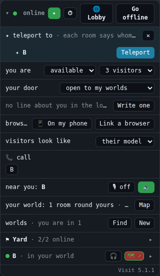

# Teleport

**Gives your user:** the rooms that would take them now, each by that room's own rule, their own room first (5.2: listed
even while they are in it, to go to its pad from wherever they are); and a way to go to one. Before it goes, a
teleport waits the length of the user's own animation's `out` (5.2), held where they stand; how they look going and
coming is their animation, played by the rooms that choose to (SPEC.md 8.15, INTEGRATING.md step 10). This widget is
the list, and the ways to open it.

**Your room needs it:** on every room from 5.1, whether or not your room takes teleports itself. Your user can teleport
out to other rooms, and home again, from anywhere: without this widget they cannot, though everything under it works.
(Your room's *pad*, and who may come into it, is your room's own choice: INTEGRATING.md step 10.)

**The reference:** the panel's **✦**, in its first line; **T**, anywhere but a box of your page's; and `ui.teleports(on)`,
for your own button or a click on your pad. The list opens under the panel's first line, folded or not. A room with a
teleport widget of its own (a popup, say) leaves the panel's out: `VisitUI.panel(element, v, { teleport: false })`
(5.2), and opens its own from its button, its key and its pad.



| What it does | Built on |
|---|---|
| Asks the rooms (again, each time it opens), and says it is asking | `v.findTeleports()` (a Promise of the list; asked again within 1.6 s: the list just found), `v.teleportAsking` ("change") |
| The rooms that said yes, as they say it, yours first | `v.teleportTargets` (`[{ key, name, user, home }]`, "teleports"); the room your user is in (`v.roomHere.key`): mark it, "to its pad" (5.2) |
| Whether this lobby carries teleports (else only your own room can say yes) | `v.teleportLobby` |
| Teleport, to one | `v.teleport(key)` (a Promise of `{ ok, reason }`) |
| Going (2 s charging, then on its way), there, or why not | `v.teleporting` (`{ key, name, ... }` while one goes), "teleport" (`{ state: "leaving" \| "arrived" \| "failed", key, name, reason }`; reasons: `not_allowed`, `declined`, `timeout`, `gone`, `full`, `not_supported`, `no_world`, `offline`, `refused`, `no_pad`, `here`, `too_many`) |

## Opening it from your room

A button in your own UI calls `ui.teleports()` (the reference's handle: it turns the list over; `true` opens it, `false`
closes it, and it says what it is now). If your room has a pad, a click on it should open the list too: it is the
thing in your room that says "teleport", and only your page can wire it, as only your page knows it is your pad.

Give the pad a name (names travel with your scene; `userData` does not), and look for it under your user's click.
On a person's page drawing a world (the engine's: your room as its host sends it), that is `world.room`; on a page
that draws its own room, your own scene:

```js
pad.name = "teleport:pad";   // in your room's scene, where you build it

// your page's click (a raycaster from your camera through the pointer):
const root = world.room || scene;
const hit = raycaster.intersectObject(root, true).find(h => !h.object.isSprite);
for (let o = hit && hit.object; o; o = o.parent) if (o.name === "teleport:pad") { ui.teleports(true); break; }
```

A visitor's click on your pad is theirs: their page's widget, not yours (Visit gives your room their point, never their
screen).

## If you build your own, it must

- open from somewhere your user finds without hunting: a button they can see, and, if your room has a pad, a click on it;
- ask each time it opens (`v.findTeleports()`), say it is asking, and list each yes as it comes, your user's own room
  first (the room they are in too, marked: to its pad);
- say when this lobby carries no teleports (`!v.teleportLobby`): only their own room can be listed then;
- go on a click (`v.teleport(key)`), show that a teleport is under way (`v.teleporting`), close when it arrives, and say
  why one did not ("teleport", `failed`).

## Check

Two rooms on 5.1, in a world together (INTEGRATING.md step 8), each with a pad: open the list from your button, from the
key, and by clicking your pad; it shows your own room and the other's (with `allow: () => false` in the other, only
yours); Teleport there lands you on its pad; from there, the list leaves that room out, and Teleport to your own room
brings you home onto yours; from far across your own land, Teleport to your own room puts you on your pad.

[All widgets](README.md) · [UI.md](../UI.md): why your page's UI is your own
